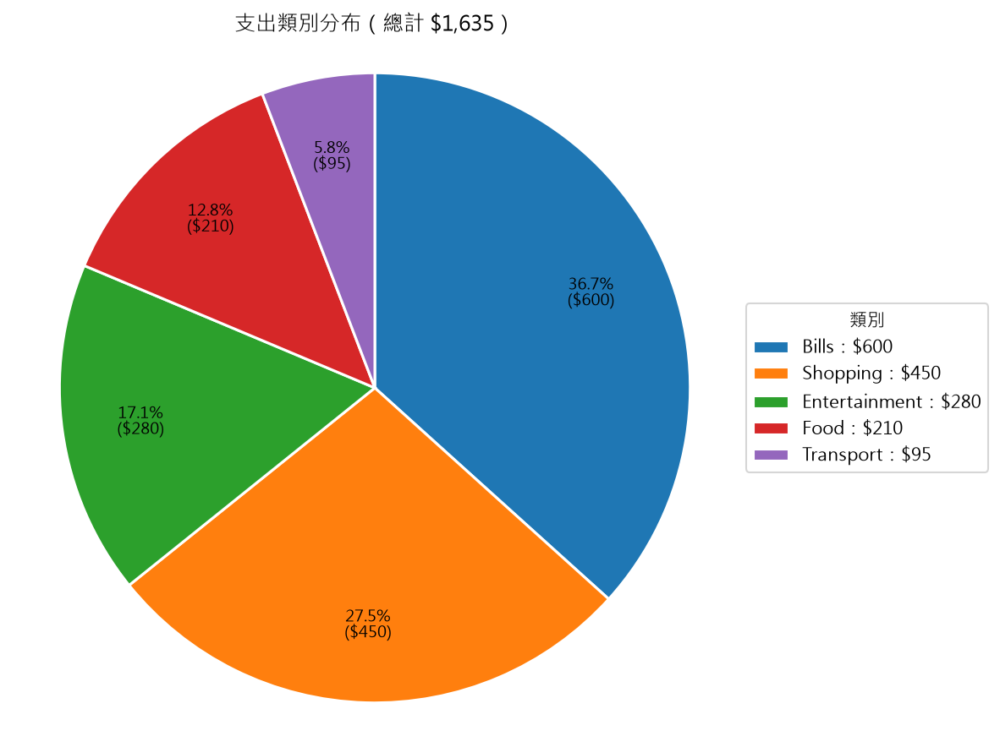

# Expense Tracker

A simple expense-tracking tool written in Python.

- **Input module** (`expense_input.py`, Member A): add expenses (date, amount, category, optional note) and save them to `data/expenses.csv`.
- **Visualization module** (`expense_chart.py`, Member B): load `data/expenses.csv` and draw a pie chart by category.

## Project Structure

```
expense-tracker/
├── expense_input.py      # Input module (Member A)
├── expense_chart.py      # Visualization module (Member B)
├── data/
│   └── expenses.csv      # Shared data file (sample data included)
├── requirements.txt
└── README.md
```

## Setup

Requires Python 3.8+.

```bash
git clone <repo-url>
cd expense-tracker
pip install -r requirements.txt
```

## How to Run

### 1. Add expenses (Input module)

```bash
python expense_input.py
```

Menu:
1. **Add expenses** – enter date (press Enter for today), amount, category (pick a number or type a custom one), and an optional note. You can add multiple records in a row.
2. **Show all expenses** – list all saved records and the total.
3. **Exit**

### 2. Draw the pie chart (Visualization module)

```bash
python expense_chart.py              # read data/expenses.csv and draw the pie chart
python expense_chart.py -m 2026-11   # only include expenses in Nov 2026
```

Options:

| Option | Description | Default |
|--------|-------------|---------|
| `-f`, `--file` | Path to the CSV data file | `data/expenses.csv` |
| `-o`, `--output` | Output image file name | `pie_chart.png` |
| `-m`, `--month` | Only include a given month (`YYYY-MM`) | all data |
| `--no-show` | Save the image without opening a window | off |

The chart is saved as `pie_chart.png`. Each slice shows the percentage and amount, and the legend lists each category's total.

<!-- Member B: describe options / output file here -->

## Data Format

`data/expenses.csv` (UTF-8, with header row):

| Column   | Type   | Example      | Required |
|----------|--------|--------------|----------|
| date     | string `YYYY-MM-DD` | 2026-11-24 | Yes |
| amount   | number (> 0)        | 120.0      | Yes |
| category | string              | Food       | Yes |
| note     | string              | lunch      | No (may be empty) |

## Sample Pie Chart



## Team

| Member | Role | Branch |
|--------|------|--------|
| A | Input module | `feature-input` |
| B | Visualization module | `feature-piechart` |
